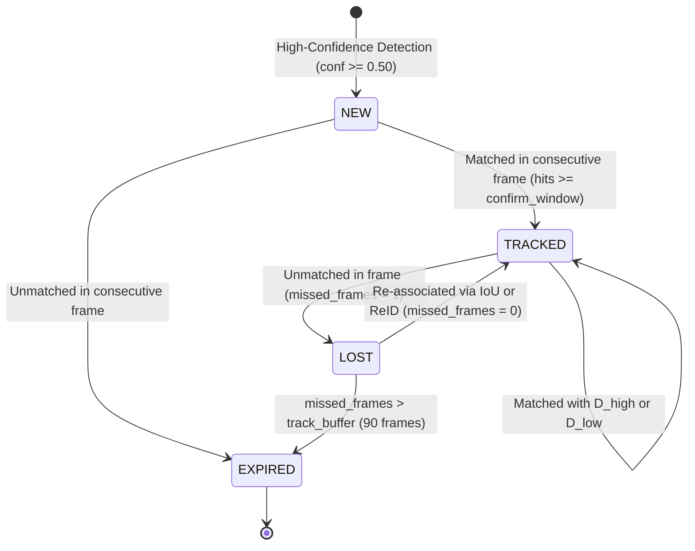
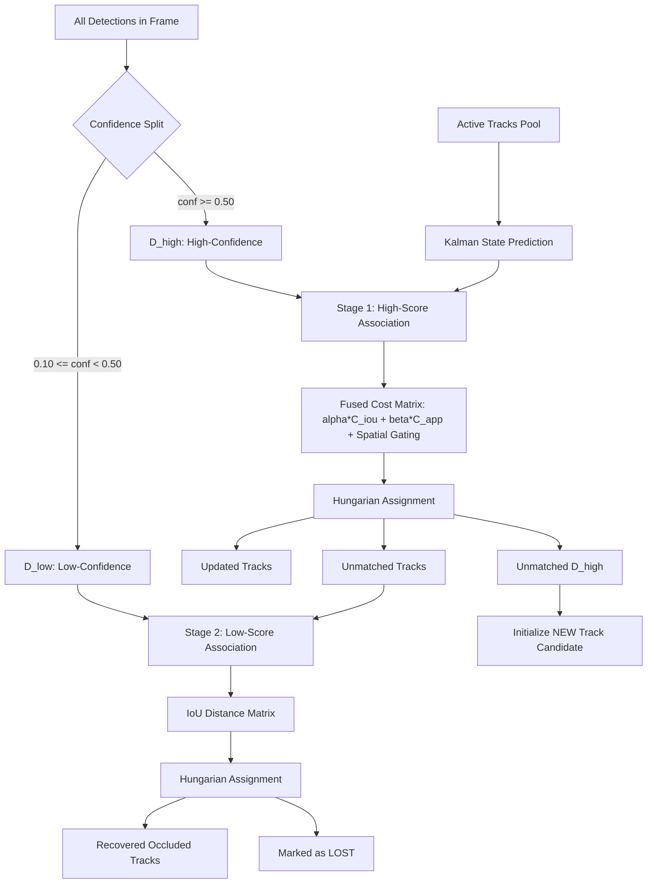
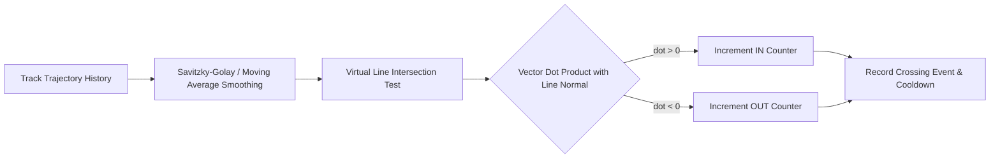

# Multi-Object Tracking System Architecture Design

## 1. System Overview and Goals

This document specifies the software architecture for our research-driven, high-accuracy Multi-Object Tracking (MOT) system on the MOT17 benchmark. The primary design objectives are:
1. **High MOTA & IDF1**: Target 80%+ where achievable via high-precision detection caching, BoT-SORT direct $(w, h)$ state Kalman filtering, and two-stage BYTE association.
2. **Robust Identity Recovery & Reduced ID Switches**: Integrate an occlusion-aware OSNet Re-ID multi-sample feature gallery and strict spatial-motion gating to prevent ID swaps when people cross.
3. **Modular and Extensible Codebase**: Strict adherence to clean architecture principles across `detection`, `tracking`, `reid`, `counting`, `evaluation`, `visualization`, and `utils`.
4. **Reproducible Quantitative Evaluation**: Standardized evaluation protocol against verified MOT17 ground truth.

---

## 2. Directory and Package Layout

```
PROJECT/
├── config/
│   ├── config.yaml              # Global hyperparameters, paths, and tracker configs
│   ├── dataset_split.yaml       # Sequence-level validation and held-out test splits
│   └── experiment_configs/      # Ablation experiment profiles
│
├── data/
│   └── MOT17/                   # Downloaded MOT17 dataset (train/ and test/)
│
├── src/
│   ├── detection/
│   │   ├── detector.py          # Unified detector interface (YOLO & public detections)
│   │   ├── preprocessing.py     # Image scaling, padding, normalization
│   │   └── postprocessing.py    # Class filtering, NMS, box format conversions
│   │
│   ├── tracking/
│   │   ├── kalman_filter.py     # BoT-SORT-style 8-state KF [cx, cy, w, h, vx, vy, vw, vh]
│   │   ├── association.py       # IoU distance, fused appearance cost, spatial gating
│   │   ├── hungarian_matcher.py # Linear assignment solver wrapper
│   │   ├── track.py             # Track entity (state, KF, gallery, age, history)
│   │   ├── track_manager.py     # Track pool manager & finite state machine
│   │   ├── tracker_baseline.py  # Preserved baseline tracker
│   │   ├── bytetrack.py         # Two-stage BYTE association tracker
│   │   ├── botsort.py           # BoT-SORT with CMC and direct (w, h) state
│   │   └── tracker.py           # Final high-accuracy hybrid ReID tracker
│   │
│   ├── reid/
│   │   ├── osnet.py             # Lightweight OSNet backbone loader & forward pass
│   │   ├── feature_extractor.py # Batch feature extraction on pedestrian crops
│   │   ├── feature_gallery.py   # Multi-sample exemplar memory + quality gating
│   │   └── reidentifier.py      # Cosine similarity matching & re-entry pool
│   │
│   ├── counting/
│   │   └── line_counter.py      # Directional virtual line person counter (IN/OUT)
│   │
│   ├── evaluation/
│   │   ├── mot_format.py        # MOTChallenge file reader/writer (gt.txt, <seq>.txt)
│   │   └── evaluator.py         # TrackEval / motmetrics runner computing MOTA, IDF1, HOTA
│   │
│   ├── visualization/
│   │   └── visualizer.py        # Video annotation: bounding boxes, IDs, trails, IN/OUT counters
│   │
│   └── utils/
│       ├── video_loader.py      # High-performance frame sequence reader
│       ├── logger.py            # Structured logging
│       └── paths.py             # Path resolution utilities
│
├── scripts/
│   ├── inspect_dataset.py       # Stage A/B dataset audit tool
│   ├── generate_detections.py   # Detection caching script (YOLO11 / public)
│   ├── run_experiments.py       # Multi-tracker ablation pipeline
│   └── evaluate_mot17.py        # Full quantitative benchmark evaluation
│
├── baseline/                    # Preserved original baseline checkpoint
├── reports/                     # Markdown and JSON technical reports
├── outputs/                     # Cached detections, trajectories, benchmark metrics
├── main.py                      # Unified command-line entry point
└── requirements.txt             # Environment dependencies
```

---

## 3. Finite State Machine (FSM) for Track Lifecycle

To eliminate track fragmentation and spurious ID creation, each track moves through a formal state machine:



### State Definitions:
1. `NEW`: Initialized from an unmatched high-confidence detection. Not yet emitted in output to prevent false positives from clutter.
2. `TRACKED`: Confirmed active track. Bounding box is emitted in predictions.
3. `LOST`: Target temporarily missing due to occlusion or detection dropout. Kalman filter continues motion prediction; appearance gallery is preserved without corruption.
4. `EXPIRED`: Track exceeded buffer limit (`track_buffer = 90` frames / 3 seconds); moved out of active association pool.

---

## 4. Two-Stage BYTE Association with Fused Appearance Cost



### Mathematical Cost Formulation:
For Stage 1:
$$C(i, j) = 
\begin{cases} 
\alpha (1 - \text{IoU}_j^i) + (1 - \alpha) (1 - \cos(e_i, f_j)), & \text{if } \text{dist}(c_i, c_j) \le \theta_{dist} \\
\infty, & \text{otherwise}
\end{cases}$$
Where $\alpha = 0.40$, $(1 - \alpha) = 0.60$, and $\theta_{dist} = 300\text{ px}$.

---

## 5. Directional Line-Crossing Counting Module



- **Vector Dot Product**: For line segment with normal vector $\vec{n} = (n_x, n_y)$ and pedestrian velocity vector $\vec{v} = (x_t - x_{t-k}, y_t - y_{t-k})$:
  $$\text{Direction} = \text{sign}(\vec{v} \cdot \vec{n})$$
- **Hysteresis & Cooldown**: A track crossing the line is locked for 30 frames to eliminate double-counting caused by jitter near the boundary.

---

## 6. Precomputing & Caching Architecture for Fast Iteration

To achieve rapid experiment turnaround on CPU, detections are precomputed once and cached in `outputs/detections_cache/<seq_name>.json`. This decouples tracker development from detector inference, reducing tracker experiment turnaround from ~6 minutes to ~1.5 seconds per sequence.

